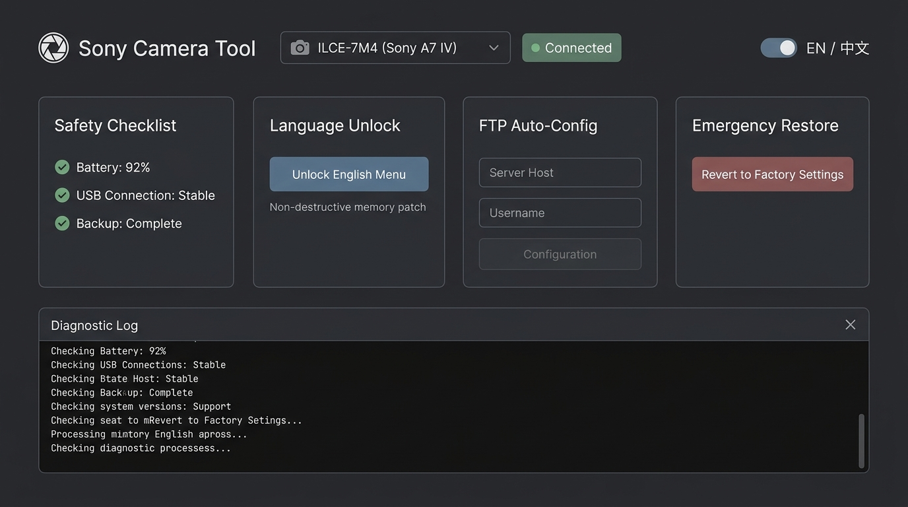

# 索尼相机工具箱 · Sony Camera Tool (v1.0.0)

**Sony Camera Tool** 是专为索尼 **α6700 (ILCE-6700 · Ver 2.00)** 与 **A7CR (ILCE-7CR · Ver 2.01)** 微单相机打造的多机型一体化工具。提供原生英文/多语言菜单解锁、完整 FTP 生态功能解锁、以及一键安全出厂状态还原。

---

## 📸 界面预览 (UI Showcase)

---

## 🚀 软件下载 (Download)

| 文件名 (File) | 大小 (Size) | 说明 (Description) | SHA256 校验码 (Checksum) |
| :--- | :--- | :--- | :--- |
| [**SonyCameraTool_v1.0.0.zip**](https://github.com/mingwucn/SonyCameraTool_Download/releases/download/v1.0.0/SonyCameraTool_v1.0.0.zip) | ~32.1 MB | 绿色免安装完整版 (包含可执行程序、内置运行时及原生物理写入载荷) | `6c02eb670a95f6fcf7377b3ae863ef3466a6289ffd4df28f336108368addf127` |

### 快速开始 (Quick Start)
1. 点击上方链接下载 `SonyCameraTool_v1.0.0.zip`。
2. 解压到本地电脑任意目录（如桌面或 `D:\SonyCameraTool`）。
3. 按照下方【安全检查清单】将相机连接至电脑后，双击运行 `SonyCameraTool.exe` 即可使用。

---

## ✨ 核心功能 (Features)

### 1. 索尼 α6700 (ILCE-6700 固件 Ver 2.00)
- **🌐 英文/多语言菜单解锁 (English Menu Unlock)**: 一键解除国行/特定区域机身的语言限制，开启英文、法文、西班牙文等全套官方原生语言。
- **⚡ FTP 完整生态功能解锁 (1-Click FTP All Features)**:
  - **网络 FTP 设置菜单**: 完整开放 FTP 传输设定、服务器连接管理、自动传输与格式化目标等选项。
  - **回放 FTP 自定义快捷键**: 在【自定义键/转盘设置】的回放选项页中开放指派“FTP传输(本图像)”，在照片/视频回放时一键秒传。
  - **回放筛选与标签修复**: 开放“已传输/未传输”图片筛选条件，并修正三级叶子菜单标签。
- **🔄 一键原厂状态还原 (1-Click Factory Restore)**: 使用固化的原厂原始字节精确回写，100% 可逆恢复原厂纯净状态，无需依赖外部备份文件。

### 2. 索尼 A7CR (ILCE-7CR 固件 Ver 2.01)
- **🌐 英文/多语言菜单解锁 (English Menu Unlock)**: 精确解除 A7CR 2.01 固件原生语言限制。
- **🔄 一键原厂状态还原 (1-Click Factory Restore)**: 一键安全可逆恢复出厂状态。

---

## ⚠️ 操作前必读与安全须知 (Mandatory Checklist)

在点击软件任何解锁或还原操作前，请务必确认以下四项检查：

1. **🔋 电量充足**: 相机电池电量在 **80% 以上**（或连接原厂交流连续电源适配器）。
2. **🔌 USB 模式**: 相机菜单设置 USB 连接模式为**【海量存储器 (MSC)】**。
   - 路径：`Menu` ➔ `网络` ➔ `USB` ➔ `USB连接模式` ➔ 选择**“海量存储器 (MSC)”**。
   - 插上线后，相机屏幕应显示黑屏白字：`“USB模式 海量存储器(MSC)”`。
3. **⏱️ 禁用自动休眠**: 在设置中关闭相机自动关机休眠计时，确保操作全程相机保持清醒。
4. **🔗 直连电脑**: 请使用优质 USB-C 数据线直接连接电脑主板接口（切勿经过 USB 拓展坞或分线器），且电脑只连接一台索尼相机。

> **安全机制保障**：软件在执行任何写入前，会自动将写前镜像双重备份至电脑本地（C 盘与 D 盘）；写入后会对每个物理字节执行即时回读校验。

---

## 🔄 操作成功后关键关机步骤 (极度重要)

当软件提示“操作完成”后，请严格执行以下关机时序：

1. **拔下数据线**: 立即从相机上拔掉 USB 数据线。
2. **正常关机**: 拨动相机机身电源开关正常【关机 (OFF)】。
3. **静候 60 秒**: **关机后请务必等待满 60 秒以上，切勿立刻开机！**
   *(原因：索尼微单关机后内部系统会在 30~50 秒内进行非易失闪存提交，将修改固化写入 `/setting/BACKUP.BIN` 持久备份！)*
4. **开机验证**: 等待满 60 秒后，仅使用电池开机验证功能。

### 如何指派回放 FTP 快捷键 (自定义键设置)
若解锁了 FTP 快捷键功能，开机后按如下指引设置：
1. 按 `Menu` ➔ `设置 (黄色工具箱图标)` ➔ `操作自订` ➔ `自定义键/转盘设置`。
2. 顶部切换到**【回放】标签页（第 3/3 页）**。
3. 选择顺手的按键（推荐：`C1 键`、`垃圾桶/删除键` 或 `AF-ON 键`）。
4. 将该按键功能指定为：**“FTP传输(本图像)”**。
5. 完成！在浏览照片或视频时，按一下该按键即可立刻把当前图像加入 FTP 传输队列。

---

## 🛠️ 故障排查与诊断日志发送 (Diagnostic Logs & Debugging)

如果在使用过程中遇到任何相机识别、连接异常或操作报错，软件内置了全自动会话日志记录与一键导出功能，您可以直接将日志发送给开发者进行分析：

1. **📋 复制日志 (Copy Log)**: 点击控制台下方的【复制日志】按钮，完整运行记录将一键复制至系统剪贴板，可直接在 GitHub Issue、微信或邮件中快捷粘贴发送。
2. **📁 打开日志目录 (Open Log Folder)**: 点击后直接在 Windows 文件资源管理器中定位日志文件夹。软件会在程序运行目录的 `logs/` 下（或 `%LOCALAPPDATA%\SonyCameraTool\logs`）自动按时间戳保存每次运行的 `.log` 文本文件以及最新会话文件 `sony_camera_tool_latest.log`。
3. **💾 导出日志... (Export Log...)**: 点击弹出“另存为”对话框，可将当前日志自定义保存为 `.txt` 文件以便随时打包发送。

> **隐私与安全保护**：诊断日志仅包含操作系统版本、DPI 缩放、USB PnP 设备识别状态与操作错误堆栈，**绝不记录**任何局域网 IP、WBI 原始数据、设备序列号或敏感凭据。

---

## ❓ 常见问题排查 (Troubleshooting)

- **Q: 软件状态栏提示“缺少驱动 (WinUSB Required)”？**
  - **A**: 索尼相机在 MSC 模式下默认使用 Windows 通用存储驱动。如果此前曾使用过 Zadig 绑定了 libusb-win32 驱动，可使用设备管理器卸载或重新绑定为 WinUSB 即可恢复识别。
- **Q: 软件状态栏提示“USB 模式不匹配”？**
  - **A**: 说明相机当前处于“PC遥控 (PC Remote)”或“MTP”模式。请进入相机菜单将【USB连接模式】切换为【海量存储器 (MSC)】并重新插拔数据线。
- **Q: 是否支持其他索尼机型？**
  - **A**: 目前 v1.0.0 经过严格底层逆向分析与物理真机验证，支持索尼 α6700 (Ver 2.00) 与 A7CR (Ver 2.01)。后续将持续扩展支持更多微单机型。

---

## ⚖️ 免责声明 (Disclaimer)

本项目仅用于个人学习交流与摄影工作流效率提升。请在严格阅读安全须知并确认设备就绪后使用。操作涉及相机内部闪存修改，请遵守各项安全规范。
