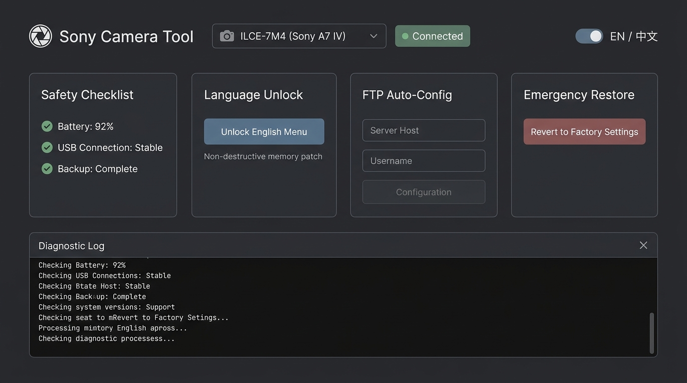

# Sony Camera Tool (v1.0.0)

**Sony Camera Tool** is an all-in-one desktop utility tailored for **Sony α6700 (ILCE-6700 · Firmware 2.00)** and **Sony A7CR (ILCE-7CR · Firmware 2.01)** cameras. It provides native English/multi-language menu unlocks, full FTP ecosystem feature activation, and 1-click safe factory stock restoration.

Designed with a tranquil **Morandi color palette**, embedded Noto Sans SC vector typography, Windows Per-Monitor V2 high-DPI scaling, and real-time English / Simplified Chinese bilingual switching.

---

## 📸 Interface Preview

---

## 🚀 Download

| File | Size | Description | SHA-256 Checksum |
| :--- | :--- | :--- | :--- |
| [**SonyCameraTool_v1.0.0.zip**](https://github.com/mingwucn/SonyCameraTool_Download/releases/download/v1.0.0/SonyCameraTool_v1.0.0.zip) | ~32.1 MB | Standalone portable Windows package (includes runtime & physical payloads) | `6c02eb670a95f6fcf7377b3ae863ef3466a6289ffd4df28f336108368addf127` |

### Quick Start
1. Download `SonyCameraTool_v1.0.0.zip`.
2. Extract the archive to any folder on your computer.
3. Follow the **Safety Checklist** below, connect your camera via USB, and double-click `SonyCameraTool.exe`.

---

## ✨ Features

### 1. Sony α6700 (ILCE-6700 Body 2.00)
- **🌐 English Language Menu Unlock**: Unlocks English and other native regional language packs on regional bodies.
- **⚡ FTP All Features (1-Click Bundled Unlock)**:
  - **Network FTP Settings Menu**: Exposes full FTP server configuration, auto-transfer targets, and background transfer settings.
  - **Playback FTP Custom Key Shortcut**: Enables "FTP Trans. (This Img.)" assignable in Custom Key (Playback tab 3/3) for single-press transfer during playback.
  - **Playback Filter & Transferred-Image Label**: Enables filtered playback condition permissions and corrects the leaf menu label.
- **🔄 1-Click Factory Restore**: Reverts all modifications back to canonical factory stock preimages without needing external backup files.

### 2. Sony A7CR (ILCE-7CR Body 2.01)
- **🌐 English Language Menu Unlock**: Unlocks English language options on A7CR Body 2.01.
- **🔄 1-Click Factory Restore**: Safely restores factory stock settings.

---

## ⚠️ Preparation & Safety Checklist (Mandatory)

Before executing any write or restore operations, verify:

1. **🔋 Battery**: Camera battery is charged **above 80%** (or connected to continuous AC power).
2. **🔌 USB Mode**: USB Connection Mode is set to **Mass Storage (MSC)**.
   - Menu ➔ Network ➔ USB ➔ USB Connection Mode ➔ Select **Mass Storage**.
   - Camera screen should show black background with: `USB Mode: Mass Storage (MSC)`.
3. **⏱️ Auto Power-Off**: Disable auto power-off in camera settings to keep the camera awake.
4. **🔗 Direct USB**: Connect directly to your computer (no USB hubs or splitters). Exactly one camera connected.

---

## 🔄 Critical Post-Operation Steps

After the tool displays "Operation Succeeded", follow these steps:

1. **Unplug USB**: Disconnect the USB-C cable from the camera immediately.
2. **Power Off**: Turn the camera main power switch to **OFF**.
3. **Wait 60 Seconds**: **Wait at least 60 full seconds before touching the power switch!**
   *(Sony cameras commit flash settings to `/setting/BACKUP.BIN` during this 30-50s window).*
4. **Power On**: Turn the camera switch to **ON** with battery power only.

### How to Assign Playback FTP Custom Key
1. Press `Menu` ➔ `Setup (Yellow suitcase icon)` ➔ `Operation Customize` ➔ `Custom Key/Dial Setting`.
2. Switch to the **Playback tab (page 3/3)**.
3. Select your preferred key (e.g. C1 or Trash/Delete button).
4. Assign the function: **`FTP Trans. (This Img.)`**.
5. Done! During photo/video playback, pressing that key will immediately transfer the item via FTP.

---

## 🛠️ Diagnostic Logs & Debugging Support

If you encounter camera detection issues, USB driver errors, or unexpected operation failures, the tool includes a comprehensive persistent session logging system:

1. **📋 Copy Log**: Click the "Copy Log" button on the console toolbar to instantly copy all execution output to your system clipboard, ready to paste in GitHub Issues or bug reports.
2. **📁 Open Log Folder**: Click to reveal the logging directory in Windows File Explorer (located at `<tool_dir>\logs\` or `%LOCALAPPDATA%\SonyCameraTool\logs`). Timestamped logs (`sony_camera_tool_YYYYMMDD_HHMMSS.log`) and the latest session (`sony_camera_tool_latest.log`) are stored automatically.
3. **💾 Export Log...**: Click to choose a custom save destination (`.txt`) for the current session log.

> **Privacy & Security**: Logs record only OS version, DPI scale, USB PnP device connection state transitions, and Python error tracebacks. **No** IP addresses, WBI flash dumps, serial numbers, or sensitive data are ever recorded.
